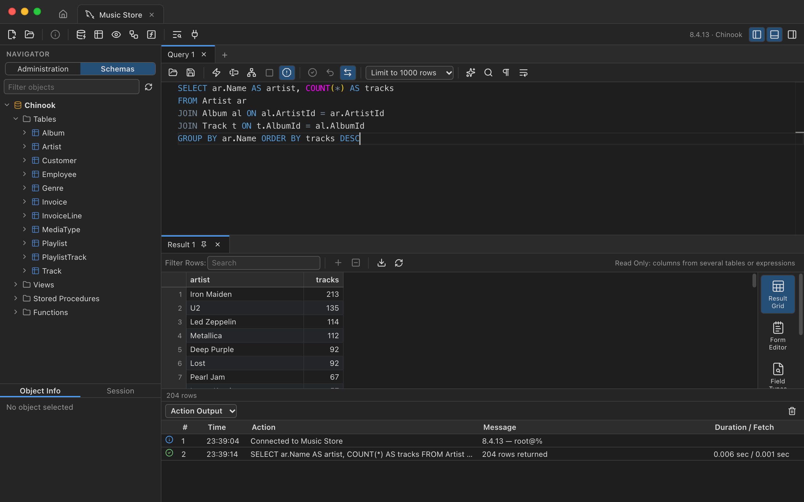

# DBKnife

**SQL editor and database administration for MySQL, MariaDB, PostgreSQL, SQL Server and SQLite.**

[](#built-with-ai--and-proud-of-it)
[](LICENSE)



## Download

| Platform | Download | Updates |
|---|---|---|
| **macOS** 12 or later, Apple Silicon | [DBKnife-mac-arm64.dmg](https://github.com/smelzo/dbknife/releases/latest/download/DBKnife-mac-arm64.dmg) | automatic |
| **macOS** 12 or later, Intel | [DBKnife-mac-x64.dmg](https://github.com/smelzo/dbknife/releases/latest/download/DBKnife-mac-x64.dmg) | automatic |
| **Windows** 10 and 11 *(beta)* | [Microsoft Store](https://apps.microsoft.com/detail/9PHQ3Q8SM96J), or the [installer for x64](https://github.com/smelzo/dbknife/releases/latest/download/DBKnife-win-x64-setup.exe) | Store: automatic; installer: download the new version |
| **Linux** x64 *(beta)* | [.deb](https://github.com/smelzo/dbknife/releases/latest/download/DBKnife-linux-amd64.deb) for Debian and Ubuntu, [AppImage](https://github.com/smelzo/dbknife/releases/latest/download/DBKnife-linux-x86_64.AppImage) for other distributions | download the new version |

- **macOS**: open the `.dmg` and drag DBKnife to Applications; from there it updates itself. The
  app is signed and notarized by Apple: on the first start macOS only asks for confirmation, as
  for any app downloaded from the Internet.
- **Windows**: the installer is not signed yet, so SmartScreen shows "Windows protected your PC":
  choose *More info → Run anyway*. The Microsoft Store version has no warning and updates itself.
- **Linux**: the AppImage has to be made executable before the first start (*Properties →
  Allow executing as program*, or `chmod +x`).
- **Beta**: DBKnife is developed and used every day on macOS. The Windows and Linux versions are
  built from the same code, but have been tried much less.

All versions and their changes are on the [Releases](https://github.com/smelzo/dbknife/releases) page.

## Features

- **SQL editor**: syntax highlighting, completion of schemas, tables and columns (through aliases
  too), formatting, find and replace, snippets; run everything, the selection or the statement
  under the cursor, and stop a query that takes too long.
- **Results** in a fast grid (hundreds of thousands of rows) with filter and sort. Edit cells,
  insert and delete rows: every change is shown as SQL before it is applied.
- **Visual execution plans**, to see why a query is slow.
- **Object editors** for tables (columns, indexes, foreign keys, triggers), views, procedures,
  functions and triggers. The table editor writes the smallest `ALTER TABLE` that makes the change.
- **Administration**: server status with live charts, client sessions, server variables, users,
  roles and privileges, backup and restore.
- **Import and export**: results to CSV, TSV, JSON, SQL `INSERT`, HTML and Excel; CSV files and
  spreadsheets (xlsx, xls, ods) into a table.
- **Files**: SQLite databases and CSV files open like a connection. A CSV file is edited as a table
  and saved back in its own format.
- **Connections** over SSH tunnels (password, key file, agent) and SSL, with passwords kept in the
  system keychain. Each connection can be marked Production, Staging, Test or Development, and
  shows it on its tab.
- **Safety**: Safe Updates refuses `UPDATE` and `DELETE` without `WHERE`; unsaved edits and open
  transactions are confirmed before closing.
- Light and dark theme; English and Italian built in, other languages as [language packs](#languages).

What each database gets:

| | MySQL, MariaDB | PostgreSQL | SQL Server 2017+ | SQLite |
|---|:-:|:-:|:-:|:-:|
| SQL editor, results, grid editing | ✓ | ✓ | ✓ (T-SQL, `GO` batches) | ✓ |
| Visual execution plan | ✓ | ✓ | ✓ | ✓ |
| Table, view and routine editors | ✓ | ✓ | ✓ | ✓ |
| Server status, sessions, variables | ✓ | ✓ | ✓ | — |
| Users and privileges | ✓ | ✓ (roles) | ✓ (logins, users, roles) | — |
| Backup and restore | `mysqldump` | `pg_dump` | `.bacpac`, `.bak` | — |
| Also | Copy Database | sequences, types, extensions | SQL Server Agent jobs (read-only) | — |

Backup and restore use the database's own command-line tools (`mysqldump` and `mysql`,
`pg_dump` and `psql`, `sqlpackage`), which have to be installed: DBKnife finds them in the usual
places, or you set their path in Preferences.

Not included: visual data modeling (ER diagrams).

## Languages

English and Italian are built in. Any other language can be added as a language pack, a JSON file
installed from *Preferences → Language → Install Language…* and used after a restart. To make one,
copy [`src/shared/i18n/en_US.json`](src/shared/i18n/en_US.json), change `locale`, `name` and
`nativeName`, and translate the messages, keeping the `{name}` placeholders. A message with
`{count}` can have plural forms (`one`, `other` and the others of `Intl.PluralRules`). Missing
messages fall back to English, so a pack keeps working with later versions of the app.

## Built with AI — and proud of it

DBKnife was written almost entirely by an AI coding agent, [Claude Code](https://claude.com/claude-code),
directed by one person. I believe the idea matters more than its implementation: knowing what a
tool should do, for whom and why. 

## Support and contributions

DBKnife is shared as is: the code is yours to use, change and fork under the MIT license. I build
it for my own work and in my spare time, so I can't promise to answer issues or review pull
requests. If you need a change, a fork is the fastest way to get it.

## Building from source

You need [Node.js](https://nodejs.org) 24 and [pnpm](https://pnpm.io) 10.

```sh
pnpm install
pnpm dev     # runs the app with hot reload
pnpm test    # unit tests
pnpm build && pnpm exec electron-builder -c.mac.identity=null   # unsigned package for your system, in dist/
```

`bin/` holds prebuilt executables of d-spread, the helper that reads and writes
spreadsheets, with its license in `bin/d-spread-LICENSE.txt`.

## License

[MIT](LICENSE) © 2026 Francesco Smelzo. The licenses of the bundled third-party software are in
`THIRD-PARTY-NOTICES.txt`, inside the installed app.
